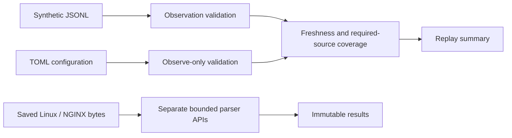

# Architecture and code map

The current package is an offline control-plane foundation. All three CLI commands are
routed by [__main__.py](../src/aegis_control/__main__.py). Library APIs consume explicitly
supplied bytes or immutable values; no native tailer or network collector runs in the background.

The parser branch and replay branch are separate APIs. Integration, live detection and response
are future work. Exact cumulative differences require supported fields, fresh ordered samples,
matching declared identities and explicit whole-interval continuity. A failed interval must not
be bridged with an older good baseline.

## Source navigation

| Component | Source | Contract |
| --- | --- | --- |
| Observe configuration | [config.py](../src/aegis_control/config.py) | [Example schemas](../configs/README.md) |
| Observations/replay/coverage | [telemetry.py](../src/aegis_control/telemetry.py), [replay.py](../src/aegis_control/replay.py), [coverage.py](../src/aegis_control/coverage.py) | [Replay](OFFLINE_REPLAY.md) |
| Counter baselines | [counters.py](../src/aegis_control/counters.py) | [Counter transitions](COUNTER_DELTAS.md) |
| Bounded event sequences | [counter_sequence.py](../src/aegis_control/counter_sequence.py), [sequence_fixture.py](../src/aegis_control/sequence_fixture.py) | [Sequences](COUNTER_SEQUENCES.md), [wire codec](SEQUENCE_FIXTURES.md) |
| TcpExt snapshots | [netstat_snapshot.py](../src/aegis_control/netstat_snapshot.py) | [Netstat](NETSTAT_SNAPSHOTS.md) |
| Kernel comparison/differences | [kernel_comparison.py](../src/aegis_control/kernel_comparison.py), [kernel_differences.py](../src/aegis_control/kernel_differences.py) | [Eligibility](KERNEL_COMPARISONS.md), [differences](KERNEL_DIFFERENCES.md) |
| Occupancy/interface inputs | [conntrack.py](../src/aegis_control/conntrack.py), [netdev.py](../src/aegis_control/netdev.py) | [Conntrack](CONNTRACK_SCALARS.md), [interface statistics](NETDEV_SNAPSHOTS.md) |
| TCP SNMP | [snmp_snapshot.py](../src/aegis_control/snmp_snapshot.py), [snmp_comparison.py](../src/aegis_control/snmp_comparison.py), [snmp_differences.py](../src/aegis_control/snmp_differences.py) | [Parser](SNMP_SNAPSHOTS.md), [comparison](SNMP_COMPARISONS.md), [differences](SNMP_DIFFERENCES.md) |
| NGINX saved records/batches | [nginx_access.py](../src/aegis_control/nginx_access.py), [nginx_batch.py](../src/aegis_control/nginx_batch.py) | [Records](NGINX_ACCESS_RECORDS.md), [batches](NGINX_RECORD_BATCHES.md) |

The two comparison consumers share a narrow private reason policy in `_comparison_core.py`;
their public input domains stay separate. Conntrack occupancy and gauges are not cumulative
event counters. A declared 32-bit TcpExt profile does not restrict unrelated uint64 sections.

## Privacy and failure semantics

Replay strips queries for its exact route catalog; NGINX records containing query/fragment data
instead become OTHER. This distinction avoids interpreting a saved access log as trusted telemetry.
NGINX batch envelope errors reject the whole document before row decoding. Expected row errors
remain visible as INVALID placeholders; unexpected exceptions propagate.

Interfaces use explicit unavailable reasons, atomic malformed-input errors, immutable results
and finite byte/key/record limits. Inspect the contracts before connecting an API to real input.
